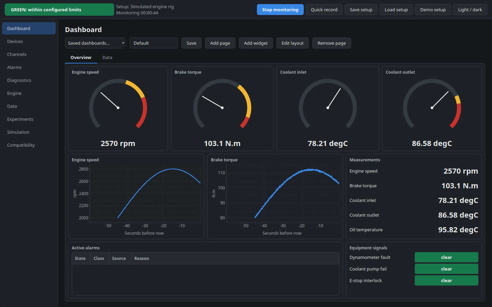

# Engine DAQ Telemetry

A hardware-agnostic data acquisition and monitoring platform for engine test rigs. Connect
your instruments, define your own measurement channels, watch them live, and get clear alarms
when something looks wrong.

> **Monitoring only.** This software reads data. It cannot stop, load or control an engine or
> dynamometer, and it does not replace a rig's independent safety system.

## Quick start

You need Python 3.10 or newer.

| System | Start it with |
|---|---|
| Windows | double-click `Python/run.bat` |
| Linux or macOS | `./Python/run.sh` |

The first run creates a private environment inside `Python/.venv`, installs everything there and
starts the app. That needs internet access, a few minutes and about 1.3 GB of disk. After that
it starts straight away and works offline. Nothing is installed outside the folder.

It opens on a simulated rig, so you can try everything with no hardware. Press
**Start monitoring**, then use the **Simulation** page to inject faults.

## What it does

- **Works with many instruments:** serial, TCP/UDP, Modbus, CAN and CAN FD, NI-DAQmx, VISA/GPIB and
  OPC UA. A new instrument can be added as a plugin without changing the core.
- **Measures whatever you define:** channels, units, calibration, limits and formulas are all set
  in the app.
- **Separates a bad reading from a real fault:** yellow means a suspicious measurement. Red means a
  verified fault, a lost critical sensor or a configured critical limit.
- **Never hides data:** raw samples are kept and questionable ones are flagged, not removed.
- **Reports health honestly:** communication, instrument, measurement and equipment health are shown
  separately, and unknown stays unknown.
- **Supports fixed and variable compression ratio,** always showing how each value is known.
- **Exchanges data** as CSV, Excel, JSON, XML, MAT, HDF5 and Parquet, with PDF reports and figures.
- **Has custom dashboards** in light and dark themes.

## Project status

Early version (0.1.0). Tested on Linux with Python 3.14. Windows and macOS are supported by design
but have not been run yet.

**No driver has been validated on a physical instrument yet.** Check any new device against a
trusted reference before relying on its readings. The
[hardware compatibility matrix](Python/docs/HARDWARE_COMPATIBILITY.md) records how far each
interface has been verified.

## Documentation

- [User guide (PDF)](Python/docs/user_guide.pdf)
- [Application README](Python/README.md)
- [Architecture](Python/docs/ARCHITECTURE.md)
- [Writing a hardware driver](Python/docs/DRIVER_GUIDE.md)
- [Contributing](Python/CONTRIBUTING.md)

## Licence

Copyright (C) 2026 Kabir Dhingra

This program is free software: you can redistribute it and/or modify it under the terms of the
GNU General Public License as published by the Free Software Foundation, version 3.

This program is distributed in the hope that it will be useful, but WITHOUT ANY WARRANTY; without
even the implied warranty of MERCHANTABILITY or FITNESS FOR A PARTICULAR PURPOSE. See the [LICENSE](LICENSE) file for details.
